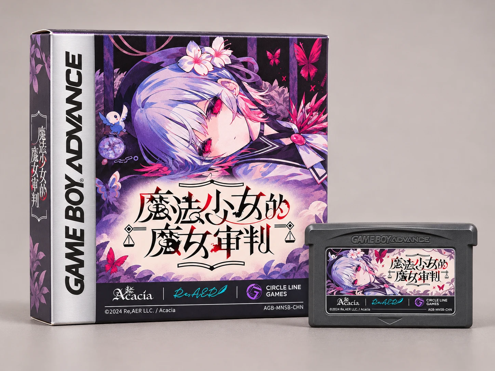
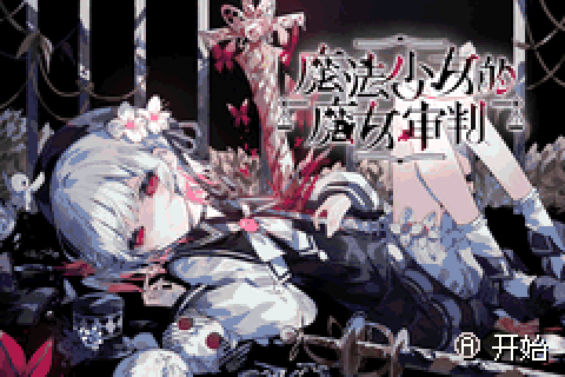
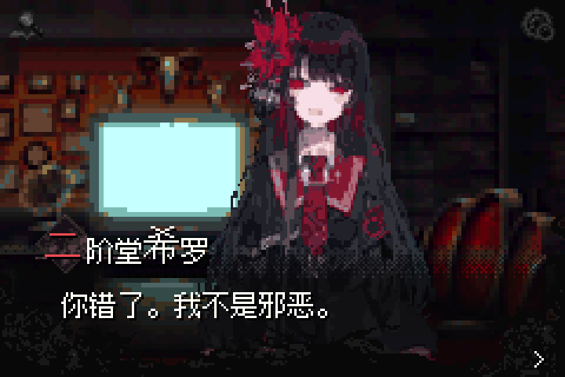
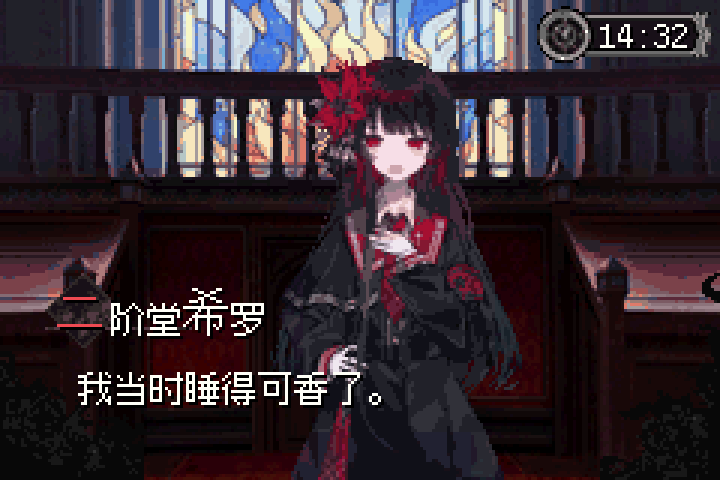
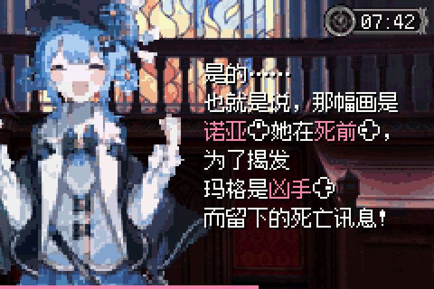

# 魔法少女的魔女审判 GBA 移植

基于 Steam 简体中文版进行移植。不包含 NS 版新增内容。



 

 

## 操作

| 画面 | 操作 |
| --- | --- |
| 普通对话 | A 推进剧情；L 对话历史回顾 |
| 故事／审判 | Select 魔女图鉴；Start 打开菜单 |
| 审判讨论 | A 推进当前句；上／左／右 进行异议 |

## 编译

```sh
make -C gba setup            # 配置 Butano
make -C gba music-tools      # 首次安装本地 mmutil
make -C gba release -j12     # 正式版：gba/manosaba-release.gba
make -C gba -j12             # 开发版：gba/manosaba.gba
make -C gba release SAVE_BACKEND=sram -j12  # SRAM兼容正式版：gba/manosaba-release-sram.gba
```

需要 Python 3、Make、宿主 C/C++ 编译器与 Wonderful GBA Toolchain 或 devkitARM。

开发版从暂停菜单的设置选项里进入调试菜单。

仓库中包含转换好的一切资产，如果需要从原作提取资产，见[资产管线](docs/pipeline.md)。

## 使用的 AI

开发：GPT-6.1 Sol（共使用了 ~2200M tokens，订阅成本 ~175 元）

逆向：DeepSeek V4.1 Flash（成本 ~20 元）

扒谱：[MuScriptor](https://muscriptor.kyutai.org)

## 版权声明

一切原作素材权利归 Acacia / Re,AER、CIRCLE LINE GAMES 等权利人所有，请支持正版游戏。

部分音乐基于网上的琴谱制作。来自 bilibili [wzd啊](https://space.bilibili.com/1489276507) 和 MuseScore [AlexChen233](https://musescore.com/user/33942334)。

## 维护文档

- [管线、准备资产与外部音乐输入](docs/pipeline.md)
- [架构、状态和存档](docs/architecture.md)
- [测试入口与精简审计](docs/testing.md)
- [已知问题与最近一次全量验证](docs/known-issues.md)
- [中文剧本格式](story/README.md) · [校字记录](story/typo-corrections.md)

发布 Flash ROM 为 30,034,992 B，距离 32 MiB 上限还剩 3,519,440 B。原作安装、完整解包媒体、开发环境、缓存和测试输出不纳入版本控制。

Flash版提供27个手动槽，SRAM兼容版提供8个手动槽；两版另有自动档和重试。正文固定1254B，详见[存档容量](docs/save-capacity.md)。使用[存档转换工具](https://imgsrc.chyk.ink/manosaba-gba-save-converter.html)在两版之间迁移，支持电脑／手机及.sav／.srm。
